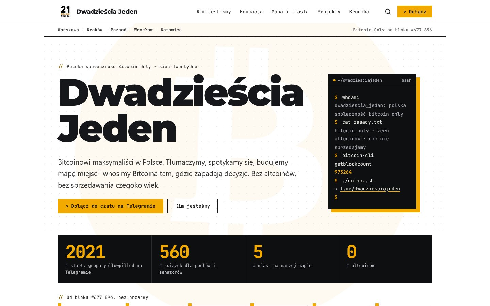

<div align="center">


# Dwadzieścia Jeden 🟠

**Polska społeczność Bitcoin Only · część sieci [TwentyOne](https://twentyone.world/)**

Bitcoin Only od bloku **#677 896** ⛏️

[🌐 dwadziesciajeden.pl](https://dwadziesciajeden.pl) · [💬 Telegram](https://t.me/dwadziesciajeden) · [𝕏 @21BitcoinPolska](https://x.com/21BitcoinPolska) · [🟣 Nostr](https://primal.net/p/nprofile1qqsvqakqcq93r06sn26ks6626n8yw83jx90cv0csvnq24x57mwpwh4gx83su2) · [📡 RSS](https://dwadziesciajeden.pl/rss.xml)

<br>

<a href="https://dwadziesciajeden.pl"></a>

</div>

---

## 👋 Cześć!

Jesteśmy bitcoinowymi maksymalistami z Polski. Tłumaczymy, spotykamy się, budujemy mapę miejsc, gdzie zapłacisz bitcoinem, i wnosimy Bitcoina tam, gdzie zapadają decyzje.

Bez altcoinów. Bez sprzedawania czegokolwiek. Bez porad inwestycyjnych. Po prostu Bitcoin, po polsku. 🧡

To repozytorium to kod naszej strony. Jeśli trafiłeś tu przypadkiem: **[wejdź na stronę](https://dwadziesciajeden.pl)** albo **[wpadnij na czat](https://t.me/dwadziesciajeden)**. Żadne pytanie nie jest głupie.

## 🧭 Kim jesteśmy

| | |
|---|---|
| 🟡 **2021** | Zaczynamy jako grupa *yellowpilled* na Telegramie. Pierwsze tłumaczenia i pierwsze piwo w Warszawie. |
| 2️⃣1️⃣ **2022** | Dołączamy do międzynarodowej sieci TwentyOne jako **Dwadzieścia Jeden**. Startuje strona i pierwszy meetup w Warszawie. |
| 🎬 **2023** | Z naszej społeczności wyrasta [Bitcoin FilmFest](https://bitcoinfilmfest.com/). Poznań, Trójmiasto, własny relay Nostr i Bitcoinowa Mapa Polski. |
| 🎓 **2024** | Przedmiot o Bitcoinie na PJATK, Bitcoin w Polskim Radiu, BitcoinWalki w Poznaniu. |
| 📚 **2025–2026** | [**Standard Bitcoina w polskim Parlamencie**](https://dwadziesciajeden.pl/bitcoin-w-parlamencie/): 560 książek dla posłów, senatorów i Prezydenta, sfinansowanych w bitcoinie przez 80 osób. |

Całą historię znajdziesz w [📜 Kronice](https://dwadziesciajeden.pl/kronika/).

## 🤝 Co robimy

- 🗣️ **Tłumaczymy:** whitepaper, Bitcoin Core, SeedSigner i teksty, które warto znać, po polsku.
- 🍻 **Spotykamy się:** meetupy i BitcoinWalki w Warszawie, Krakowie, Poznaniu, Wrocławiu i Katowicach.
- 🗺️ **Mapujemy:** [Bitcoinowa Mapa Polski](https://dwadziesciajeden.pl/bitcoinowa-mapa-polski/), czyli gdzie zapłacisz bitcoinem.
- 📖 **Uczymy:** [Edukacja](https://dwadziesciajeden.pl/edukacja/) z biblioteką polskich książek, stron i nagrań.
- 🏛️ **Działamy:** książki w Sejmie, uwagi do ustaw, zbiórki w satsach.
- 🤝 **Mamy przyjaciół:** [projekty nasze i zaprzyjaźnione](https://dwadziesciajeden.pl/projekty/).

## 📍 Gdzie nas znaleźć

| | |
|---|---|
| 💬 Czat na Telegramie | [t.me/dwadziesciajeden](https://t.me/dwadziesciajeden) |
| 🟣 Społeczność na Nostrze | [Armada](https://armada.buzz/c/50bb9c75a72e30c95c2a0cd7e3b4bf39e6e3b81faa9d5bf65aa25a10dc5b21c6/4e95853f368df5a47d306a7ab7233e3c5451b7ef55279417498fa9be7c7c5c4d/m/6f327e5556b324781f4c9e48f575c8a2f7b1dc6c2a5b1e9463c93e1d3ef1e15b) |
| 🚶 BitcoinWalk Warszawa | soboty 11:30, Ogród Saski (Fontanna Wielka), [bitcoinwalk.org](https://bitcoinwalk.org/warszawa) |
| ☕ Bitcoin Café Warszawa | poniedziałki 18:00, [meetup.com/bitcoin-warsaw](https://www.meetup.com/bitcoin-warsaw/) |
| 🌆 Inne miasta | [Mapa i miasta](https://dwadziesciajeden.pl/bitcoinowa-mapa-polski/#miasta) |
| ✉️ Kontakt | [kontakt@dwadziesciajeden.pl](mailto:kontakt@dwadziesciajeden.pl) |

## 🧡 Zasady w skrócie

1. **Tylko Bitcoin.** Nie promujemy altcoinów ani tokenów.
2. **Nic nie sprzedajemy.** Żadnych kursów, sygnałów ani „okazji”.
3. **Not your keys, not your coins.** Klucze trzymaj u siebie.
4. **Nikt z nas nie napisze pierwszy w prywatnej wiadomości.** Jeśli ktoś tak robi, to oszust.

Pełna wersja: [Zasady i sieć TwentyOne](https://dwadziesciajeden.pl/zasady/).

## 🛠️ Chcesz pomóc przy stronie?

Strona jest statyczna: zwykły Python bez zależności buduje ją z plików JSON w `content/` do katalogu `docs/`, a GitHub Pages serwuje ją pod [dwadziesciajeden.pl](https://dwadziesciajeden.pl).

```bash
python build.py
```

Literówka, nieaktualny link, nowe miejsce na mapie albo brakująca polska książka? Otwórz issue, pull request albo po prostu napisz na [czacie](https://t.me/dwadziesciajeden). Szczegóły techniczne: [DEVELOPMENT.md](DEVELOPMENT.md).

## 📄 Licencje

**Kod** (`build.py`, `qa/`, `tools/`, szablony, CSS i JS) jest na licencji [MIT](LICENSE).

**Teksty napisane przez nas** (artykuł o Parlamencie, kronika, słowniczek) są na licencji [CC BY 4.0](LICENSE-CONTENT.md). Poza tą licencją zostają cudze teksty i cytaty, logo i znaki (w tym TwentyOne i logo projektów), okładki książek, zdjęcia, miniatury z YouTube oraz dane z mapy. [Pełna lista](LICENSE-CONTENT.md).

---

<details>
<summary>🇬🇧 In English</summary>

**Dwadzieścia Jeden** ("Twenty-One") is the Polish Bitcoin-only community and part of the [TwentyOne](https://twentyone.world/) network. Since block #677,896 (April 2021) we have been translating Bitcoin material into Polish, running meetups and BitcoinWalks in five cities, mapping places that accept bitcoin, and in January 2026 we delivered 560 copies of *The Bitcoin Standard* to every member of the Polish Parliament. No altcoins, nothing for sale, no investment advice.

This repo holds the source of [dwadziesciajeden.pl](https://dwadziesciajeden.pl). Code is MIT ([LICENSE](LICENSE)); our own original texts are CC BY 4.0 ([LICENSE-CONTENT.md](LICENSE-CONTENT.md)). Say hi on [Telegram](https://t.me/dwadziesciajeden).

</details>

<div align="center">

**Don't trust, verify.** ⚡ Zrobione z 🧡 przez polskich bitcoinerów.

</div>
